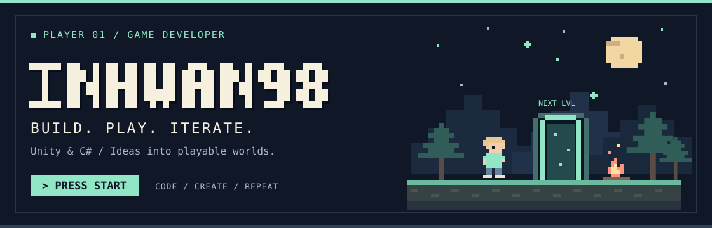
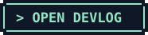
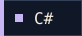
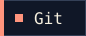
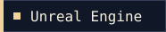

<!-- Original static pixel art lives in assets/. Edit the text and links below to update the profile. -->

  

**안녕하세요, 게임 개발자 박인환입니다.**

Unity와 C#으로 플레이 경험을 만들고, 구현과 검증의 과정을 기록합니다.

 

 

### 🏕️ 01 / MAIN QUEST

**[잿불 용병단 · 개인 게임 개발](https://inhwan98.github.io/)**

어느 칸을, 어떤 순서로 긁을까? **긁는 복권 로그라이크**를 만들고 있습니다.
기획부터 Unity 구현, 순수 C# 규칙 검증까지 직접 진행하며 개발 일지에 남깁니다.

[`개발 일지 ↗`](https://inhwan98.github.io/) · [`작업 트래커 ↗`](https://inhwan98.github.io/tracker/) · [`기획 노트 ↗`](https://inhwan98.github.io/design/)

 

### 🎒 02 / INVENTORY

  
  
  
  
  

**주력** · Unity / C# &nbsp;&nbsp; **함께 다뤄 본 기술** · Unreal Engine / C++

 

### 🗂️ 03 / SAVE FILES

공개 저장소에 남겨 둔 게임 제작과 학습 기록입니다.

| 프로젝트 | 플레이 기록 |
| :--- | :--- |
| **[RPG Project](https://github.com/Inhwan98/RPG_Project)** | Unity · C#으로 만든 RPG 포트폴리오 |
| **[3-Match Puzzle](https://github.com/Inhwan98/UnityPuzzle_Practice)** | Unity · C#으로 구현한 3매치 퍼즐 게임 |
| **[Unreal FPS](https://github.com/Inhwan98/Unreal_FPS_Practice1)** | Unreal Engine · C++ 기반 FPS 제작 연습 |

 

### 📓 04 / QUEST LOG

- **구현** — 아이디어를 직접 플레이할 수 있는 게임으로 옮깁니다.
- **검증** — 규칙을 테스트하고, 시뮬레이션 결과와 실제 플레이를 구분해 기록합니다.
- **기록** — 만든 것뿐 아니라 바꾼 이유와 다음 과제도 [개발 일지](https://inhwan98.github.io/)에 남깁니다.

 

